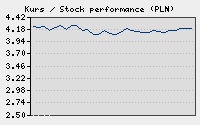

  
 

| **n e t i a** <br> *krok przed myślą* | AKTUALNOŚCI i WYDARZENIA |
| :--- | :--- |
| ───────────────────────────────────────────────────|──────────────────
| **Jesteś w:** Strona główna › Usługi internetowe › Aktualności |


# `[ netia.pl ] ─── USŁUGI INTERNETOWE ─── [ NOWOŚĆ: PRZEKAZ ]`
## `[ Przekaz ]`



```text
𝗷𝗲𝗱𝗲𝗻 𝘇 𝗻𝗮𝘀𝘇𝘆𝗰𝗵 𝗸𝗹𝗶𝗲𝗻𝘁𝗼́𝘄 𝗼𝗽𝗼𝘄𝗶𝗮𝗱𝗮:                   
"no, Panie, żebym ja jeszcze za myśli abonament płacił"
Pan Józef K. tłumaczy działanie najnowszej usługi     
następująco: "[przekaz] myśli.. pan sobie myśli, że   
pan dzwoni. ...a ja myślę, że odbieram"               
```


**Co wyróżnia naszą ofertę?**  
Oferujemy usługę przekazu opartą na wyjątkowych w skali całego rynku,<br> bardzo atrakcyjnych warunkach:
- naliczanie sekundowe
- przekaz myśli jest też na połączenia komórkowe również
- zasięg za granice nie.. nie, bo za granicą jest diabeł 
- internet w takiej usłudze? jest. tylko lepiej w nocy. <br>bo wtedy ludzie śpiom i mniej ludzi myśli.. i nie ma zakłóceń

<br clear="right"/>


## `[ Parametry Techniczne Usługi ]`

### Cennik i warunki darmowe
Wszystkie myśli w naszej sieci przesyłane są bez naliczania abonamentu. Klient Józef K. potwierdza: *żebym ja jeszcze za myśli abonament płacił?* Usługa jest darmowa zupełnie, a rozliczenia opierają się na innowacyjnej zasadzie: pan myśli, że płaci ratę, a my myślimy, że księgujemy.

### Instrukcja uruchomienia Przekazu krok po kroku
1. Skoncentruj się i pomyśl o osobie, z którą chcesz nawiązać kontakt,
2. Wyślij impuls telepatyczny za pośrednictwem infrastruktury Netii,
3. Poczekaj na zwrotne potwierdzenie odbioru myśli.

### Specyfikacja techniczna i ograniczenia
- [x] Pełna aktywacja telepatyczna w standardzie
- [x] Naliczanie sekundowe na numery stacjonarne i komórkowe
- [ ] ~~Zasięg międzynarodowy~~

| Godziny świadczenia | Poziom zakłóceń | Przepustowość myśli |
| :--- | :--- | :--- |
| Dzień (06:00 - 22:00) | Wysoki (ludzie myślą) | Średnia |
| Noc (22:00 - 06:00) | Brak (ludzie śpiom) | **Maksymalna** |

Aby sprawdzić status swojego Przekazu, przetestuj [Google Colab](http://colab.research.google.com) lub uruchom poniższy skrypt diagnostyczny w języku Python:

```python
def sprawdz_zaklocenia(godzina):
    # Ludzie śpiom i mniej ludzi myśli w nocy
    if godzina >= 22 or godzina < 6:
        return "Brak zakłóceń. Internet działa doskonale telepatycznie."
    else:
        return "Wysokie zakłócenia. Za dużo ludzi myśli!"

print(sprawdz_zaklocenia(23))
```

Wzory matematyczne opisujące propagację fal myślowych w przestrzeni Netii:

Prędkość myśli w nocy określa prosty wzór inline $E=mc^2$

Opór mentalny populacji wyrażamy jako $\Omega_{\text{mental}} = 0$, gdy wszyscy śpią.

Częstotliwość połączenia telepatycznego wynosi $f = \infty$ dla darmowych pakietów.


Zaawansowane równania wielowierszowe i macierz przesyłu Przekazu (Display Math):

$$
\sum_{i=1}^{n} M_i = 0 \quad (\text{dla t} \ge \text{22:00})
$$

$$
A = \begin{pmatrix} 1 & 2 \\ 3 & 4 \end{pmatrix}
$$

$$
\sum_{k=1}^{n} k^2 = \frac{n(n+1)(2n+1)}{6}
$$


Poniżej znajduje się wizualny wykres efektywności Przekazu wygenerowany z naszych centrali:


<br>
─────────────────────────────────────────────────────────────────────────────
<br>
*Dziękujemy bardzo za rozmowę. Niech Pan myśli o nas. Do zobaczenia.*
