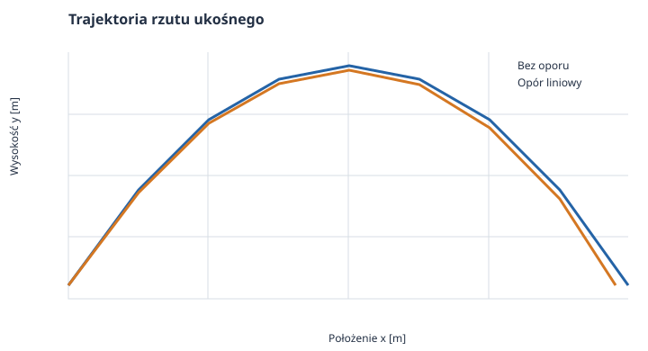
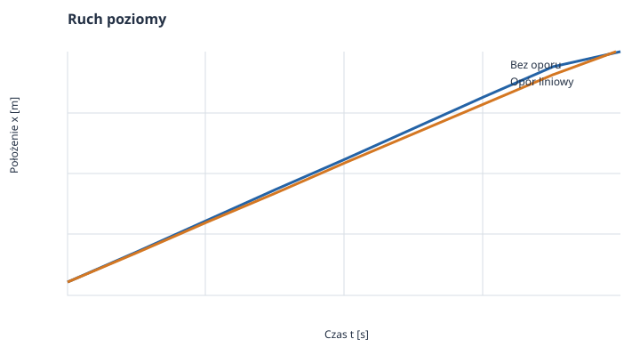
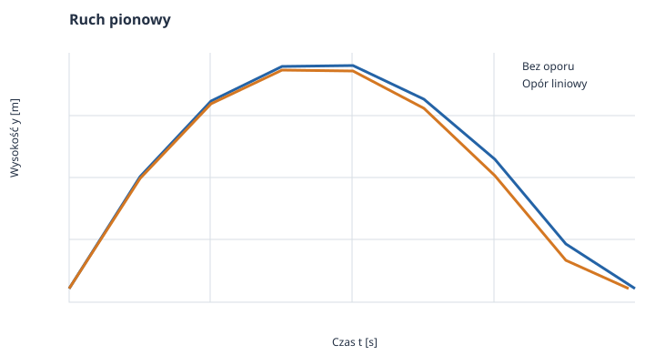
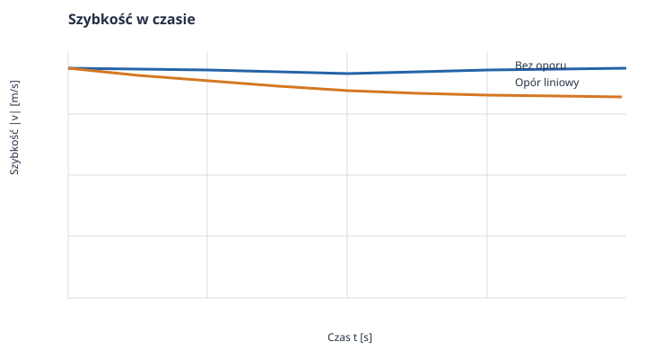
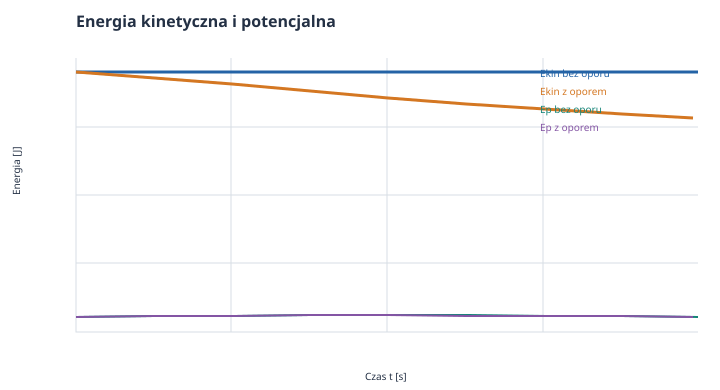
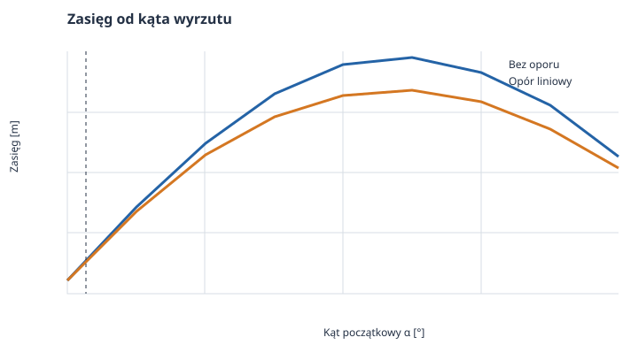

# Rzut ukośny — od paraboli do ruchu z oporem powietrza

*Raport obliczeniowy i przykład wykorzystania Markdown w dokumentacji naukowej.*

**Temat:** dwuwymiarowy ruch ciała wyrzuconego pod kątem do poziomu.  
**Metoda:** wyprowadzenie rozwiązań analitycznych, obliczenia numeryczne i interpretacja wykresów.  
**Charakter danych:** przykład modelowy; wykresy przedstawiają obliczenia, a nie pomiary.

Analizujemy rzut z prędkością początkową $v_0=34\,\mathrm{m/s}$ pod kątem $\alpha=3^\circ$. Porównamy dwa opisy: idealny, w którym pomijamy powietrze, oraz uproszczony model z siłą oporu proporcjonalną do prędkości. Niewielki kąt oznacza krótki, płaski lot, ale nawet wtedy opór zmniejsza zasięg.

## Spis treści

1. [Cel i model fizyczny](#1-cel-i-model-fizyczny)
2. [Równania ruchu bez oporu](#2-równania-ruchu-bez-oporu)
3. [Analiza i wykresy ruchu bez oporu](#3-analiza-i-wykresy-ruchu-bez-oporu)
4. [Równania ruchu z oporem liniowym](#4-równania-ruchu-z-oporem-liniowym)
5. [Symulacja i wykresy ruchu z oporem](#5-symulacja-i-wykresy-ruchu-z-oporem)
6. [Porównanie modeli](#6-porównanie-modeli)
7. [Kod i odtwarzanie wykresów](#7-kod-i-odtwarzanie-wykresów)
8. [Wnioski i ograniczenia](#8-wnioski-i-ograniczenia)
9. [Dalsza lektura](#9-dalsza-lektura)

---

## 1. Cel i model fizyczny

Początek układu współrzędnych znajduje się w miejscu wyrzutu. Oś $x$ jest pozioma i skierowana zgodnie z ruchem początkowym, a oś $y$ pionowa i skierowana ku górze. Przyjmujemy, że ciało ląduje na tej samej wysokości, z której zostało wyrzucone.

### 1.1. Założenia

- Pole grawitacyjne jest jednorodne, a przyspieszenie ziemskie wynosi $g=9{,}81\,\mathrm{m/s^2}$.
- Prędkość początkowa ma wartość $v_0=34\,\mathrm{m/s}$, a kąt z poziomem to $\alpha=3^\circ=0{,}05236\,\mathrm{rad}$.
- W modelu idealnym jedyną siłą jest ciężar.
- W modelu z oporem przyjmujemy siłę liniową $\vec F_d=-b\vec v$, gdzie $b=0{,}020\,\mathrm{kg/s}$.
- Masa wynosi $m=0{,}150\,\mathrm{kg}$. Wartość $b$ jest przykładowym parametrem modelu, a nie wynikiem pomiaru dla konkretnego obiektu.

W zapisie obliczeniowym kąty są zamieniane na radiany. Stopnie pozostają w podpisach wykresów, aby bezpośrednio pokazać zadane $3^\circ$. Pozostałe wielkości fizyczne podajemy w jednostkach SI.

### 1.2. Symbole i jednostki

| Symbol | Znaczenie | Jednostka SI |
| :--- | :--- | :---: |
| $x$, $y$ | współrzędne położenia | $\mathrm{m}$ |
| $v_x$, $v_y$, $v$ | składowe i wartość prędkości | $\mathrm{m/s}$ |
| $a_x$, $a_y$, $g$ | składowe przyspieszenia i przyspieszenie ziemskie | $\mathrm{m/s^2}$ |
| $m$ | masa ciała | $\mathrm{kg}$ |
| $b$ | współczynnik oporu liniowego | $\mathrm{kg/s}=\mathrm{N\,s/m}$ |
| $\lambda=b/m$ | odwrotność czasu relaksacji | $\mathrm{s^{-1}}$ |
| $t$, $T$ | czas i czas lotu | $\mathrm{s}$ |
| $R$, $H$ | zasięg i maksymalna wysokość | $\mathrm{m}$ |
| $E_k$, $E_p$ | energia kinetyczna i potencjalna | $\mathrm{J}$ |

## 2. Równania ruchu bez oporu

### 2.1. Rozkład warunków początkowych

Prędkość początkową rozkładamy na składowe:

$$
v_{0x}=v_0\cos\alpha,
\qquad
v_{0y}=v_0\sin\alpha.
$$

Dla przyjętych danych $v_{0x}\approx33{,}9534\,\mathrm{m/s}$ i $v_{0y}\approx1{,}7794\,\mathrm{m/s}$. W modelu bez oporu druga zasada Newtona daje:

$$
m\ddot{x}=0,
\qquad
m\ddot{y}=-mg.
$$

Po podzieleniu przez masę, a następnie całkowaniu z warunkami początkowymi $x(0)=y(0)=0$, otrzymujemy najpierw prędkości:

$$
v_x(t)=v_{0x},
\qquad
v_y(t)=v_{0y}-gt.
$$

Całkowanie prędkości daje położenie:

$$
\begin{aligned}
x(t) &= v_0\cos\alpha\,t,\\
y(t) &= v_0\sin\alpha\,t-\frac{1}{2}gt^2.
\end{aligned}
$$

### 2.2. Trajektoria, czas lotu i zasięg

Z pierwszego równania wynika $t=x/(v_0\cos\alpha)$. Podstawienie do równania pionowego eliminuje czas i daje parabolę:

$$
y(x)=x\tan\alpha-\frac{g x^2}{2v_0^2\cos^2\alpha}.
$$

Ciało wraca na poziom wyrzutu, gdy $y(t)=0$. Oprócz rozwiązania $t=0$ otrzymujemy czas lotu $T$ i zasięg $R$:

$$
T=\frac{2v_0\sin\alpha}{g},
\qquad
R=x(T)=\frac{v_0^2\sin(2\alpha)}{g}.
$$

W wierzchołku toru prędkość pionowa zanika: $v_y=0$. Stąd czas wznoszenia $t_H=v_0\sin\alpha/g$, a maksymalna wysokość wynosi:

$$
H=y(t_H)=\frac{v_0^2\sin^2\alpha}{2g}.
$$

Dla $v_0=34\,\mathrm{m/s}$ oraz $\alpha=3^\circ$ otrzymujemy $T\approx0{,}36278\,\mathrm{s}$, $R\approx12{,}31752\,\mathrm{m}$ i $H\approx0{,}16138\,\mathrm{m}$. Mała wysokość wynika bezpośrednio z małej składowej pionowej prędkości.

## 3. Analiza i wykresy ruchu bez oporu

W tym modelu składowa pozioma prędkości jest stała, a pionowa maleje liniowo z nachyleniem $-g$. Energia kinetyczna zmienia się podczas lotu, ale suma energii kinetycznej i potencjalnej pozostaje stała.



*Rysunek 1. Tor idealny jest parabolą. Wspólny układ współrzędnych pozwala porównać go bezpośrednio z torem z oporem.*



*Rysunek 2. Bez oporu $x(t)$ rośnie liniowo; z oporem pozioma składowa prędkości stopniowo maleje.*



*Rysunek 3. Wierzchołek toru występuje, gdy $v_y=0$. Po opadaniu do $y=0$ kończy się czas lotu.*



*Rysunek 4. W modelu idealnym prędkość pozioma jest stała, a pionowa zmienia się pod wpływem grawitacji.*



*Rysunek 5. Bez oporu energia mechaniczna jest zachowana. W modelu z oporem jej suma maleje.*

## 4. Równania ruchu z oporem liniowym

### 4.1. Druga zasada Newtona

Dla prędkości $\vec v=(v_x,v_y)$ siła oporu ma składowe przeciwne do ruchu. Z grawitacją $\vec F_g=(0,-mg)$ równanie Newtona przyjmuje postać:

$$
m\dot{v}_x=-bv_x,
\qquad
m\dot{v}_y=-mg-bv_y.
$$

Wprowadzamy parametr $\lambda=b/m$, o jednostce $\mathrm{s^{-1}}$. Równania prędkości są wtedy liniowymi równaniami różniczkowymi pierwszego rzędu:

$$
\dot{v}_x+\lambda v_x=0,
\qquad
\dot{v}_y+\lambda v_y=-g.
$$

Pierwsze rozwiązujemy przez rozdzielenie zmiennych: $dv_x/v_x=-\lambda\,dt$. Po użyciu $v_x(0)=v_{0x}$ otrzymujemy $v_x=v_{0x}e^{-\lambda t}$. W równaniu pionowym rozwiązanie jednorodne jest proporcjonalne do $e^{-\lambda t}$, a rozwiązanie szczególne jest stałe $-g/\lambda$. Ustalenie stałej z $v_y(0)=v_{0y}$ daje:

$$
\begin{aligned}
v_x(t) &= v_{0x}e^{-\lambda t},\\
v_y(t) &= \left(v_{0y}+\frac{g}{\lambda}\right)e^{-\lambda t}-\frac{g}{\lambda}.
\end{aligned}
$$

Całkujemy składowe prędkości i używamy $x(0)=y(0)=0$:

$$
\begin{aligned}
x(t) &= \frac{v_{0x}}{\lambda}\left(1-e^{-\lambda t}\right),\\
y(t) &= \frac{1}{\lambda}\left(v_{0y}+\frac{g}{\lambda}\right)
       \left(1-e^{-\lambda t}\right)-\frac{g}{\lambda}t.
\end{aligned}
$$

Wartość $b=0{,}020\,\mathrm{kg/s}$ przy masie $m=0{,}150\,\mathrm{kg}$ odpowiada $\lambda=0{,}13333\,\mathrm{s^{-1}}$ i czasowi relaksacji $1/\lambda=7{,}5\,\mathrm{s}$. Jest to znacznie więcej niż czas lotu w tym przykładzie, dlatego wpływ oporu jest umiarkowany.

### 4.2. Wierzchołek i lądowanie

Wierzchołek toru nadal wyznacza warunek $v_y(t_H)=0$. Rozwiązując go względem czasu, dostajemy:

$$
t_H=\frac{1}{\lambda}\ln\left(1+\frac{\lambda v_{0y}}{g}\right).
$$

Maksymalną wysokość obliczamy przez podstawienie $t_H$ do $y(t)$. Czasu lądowania nie da się tu zapisać za pomocą prostych funkcji elementarnych: dodatni pierwiastek równania $y(T)=0$ wyznaczamy numerycznie. Skrypt stosuje bisekcję, która zawęża przedział zawierający pierwiastek aż do wymaganej precyzji.

## 5. Symulacja i wykresy ruchu z oporem

Wykresy pokazują te same warunki początkowe co w modelu idealnym. Obraz obejmuje zarówno tor, jak i zmiany w czasie, dzięki czemu widać, że opór zmienia obie składowe prędkości, a nie tylko zasięg.


*Rysunek 6. Ta sama ilustracja co na rysunku 1 służy analizie krzywej z oporem; krzywa kończy się numerycznie wyznaczonym lądowaniem.*


*Rysunek 7. Nachylenie wykresu $x(t)$ jest równe $v_x(t)$ i maleje wykładniczo.*


*Rysunek 8. Wznoszenie kończy się po około $0{,}17923\,\mathrm{s}$, gdy prędkość pionowa spada do zera.*


*Rysunek 9. Opór zmniejsza szybkość względem przypadku idealnego. Wektor oporu jest zawsze skierowany przeciwnie do wektora prędkości.*


*Rysunek 10. Energia potencjalna jest liczona względem poziomu wyrzutu: $E_p=mgy$. Całkowita energia mechaniczna w obecności oporu maleje.*

## 6. Porównanie modeli

Dla zadanych warunków początkowych parametry lotu wynoszą:

| Wielkość | Bez oporu | Opór liniowy | Jednostka SI |
| :--- | ---: | ---: | :---: |
| Czas lotu $T$ | $0{,}36278$ | $0{,}35990$ | $\mathrm{s}$ |
| Zasięg $R$ | $12{,}31752$ | $11{,}93124$ | $\mathrm{m}$ |
| Czas do wierzchołka $t_H$ | $0{,}18139$ | $0{,}17923$ | $\mathrm{s}$ |
| Maksymalna wysokość $H$ | $0{,}16138$ | $0{,}15883$ | $\mathrm{m}$ |

Przy przyjętym współczynniku oporu zasięg zmniejsza się o około $0{,}38629\,\mathrm{m}$, czyli o $3{,}14\%$. Maksymalna wysokość maleje o około $0{,}00256\,\mathrm{m}$. Różnice wynikają z tego, że siła oporu zmniejsza prędkość zarówno podczas wznoszenia, jak i opadania.



*Rysunek 11. Kąt $3^\circ$ jest zaznaczony na wykresie. Krzywe porównują modele dla wielu kątów, ale tabela powyżej dotyczy wyłącznie warunków zadanych w raporcie.*

## 7. Kod i odtwarzanie wykresów

Pełny skrypt znajduje się w pliku [generuj_wykresy.py](generuj_wykresy.py). Korzysta z NumPy do obliczeń i Matplotlib do rysowania; SciPy nie jest potrzebne, ponieważ równania ruchu mają rozwiązania analityczne, a pojedynczy czas lądowania wyznaczamy prostą metodą bisekcji. Skrypt zapisuje sześć wykresów w PNG i SVG w podkatalogu `files/rzut/`.

W katalogu `pages/solutions/04_sol_vscode` uruchom:

```bash
python -m pip install numpy matplotlib
python generuj_wykresy.py
```

Najważniejszy fragment modelu z oporem:

```python
import numpy as np

v0 = 34.0
alpha = np.deg2rad(3.0)
g = 9.81
m = 0.150
b = 0.020
gamma = b / m
vx0 = v0 * np.cos(alpha)
vy0 = v0 * np.sin(alpha)

def pozycja_opor(t):
    x = vx0 * (-np.expm1(-gamma * t)) / gamma
    y = (vy0 + g / gamma) * (-np.expm1(-gamma * t)) / gamma - g * t / gamma
    return x, y
```

Funkcja `expm1` dokładniej oblicza $e^z-1$ dla małych $z$, co pomaga uniknąć utraty cyfr przy krótkich czasach. Funkcja wyznaczająca czas lądowania zmienia górną granicę przedziału, aż $y(t)$ stanie się ujemne, po czym dzieli przedział na połowy. Wygenerowane obrazy są osadzone we względnych ścieżkach, więc pozostają widoczne na GitHubie wraz z raportem.

## 8. Wnioski i ograniczenia

W modelu idealnym ruch poziomy jest jednostajny, a pionowy jednostajnie przyspieszony. Po eliminacji czasu tor ma kształt paraboli. Przy oporze liniowym prędkość pozioma zanika wykładniczo, a składowa pionowa dąży do prędkości granicznej $-g/\lambda$. Odpowiednie równania można rozwiązać analitycznie, ale czas lądowania znajduje się numerycznie.

Model $\vec F_d=-b\vec v$ jest uproszczeniem. Dla wielu obiektów poruszających się w powietrzu, zwłaszcza przy większych prędkościach, lepszy może być opór kwadratowy $\vec F_d=-c|\vec v|\vec v$. Wtedy składowe ruchu są sprzężone i na ogół trzeba całkować równania numerycznie. Wartość $b$ przyjęta tutaj służy ilustracji metody; wyników nie należy traktować jako prognozy dla konkretnego pocisku bez pomiaru parametrów aerodynamicznych.

## 9. Dalsza lektura

- [OpenStax: Projectile Motion](https://openstax.org/books/college-physics-2e/pages/3-4-projectile-motion) — rozkład ruchu na składowe i model idealny.
- [NASA Glenn: The Drag Equation](https://www1.grc.nasa.gov/beginners-guide-to-aeronautics/drag-equation/) — siła oporu aerodynamicznego i jej zależność od prędkości.
- [NumPy: `numpy.expm1`](https://numpy.org/doc/stable/reference/generated/numpy.expm1.html) — dokładne obliczanie $e^x-1$ dla małych $x$.
- [Matplotlib: dokumentacja](https://matplotlib.org/stable/) — tworzenie i zapisywanie wykresów.
